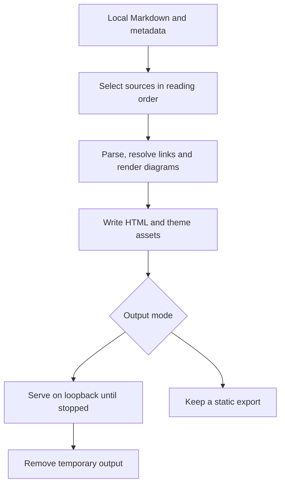

# md-render

Build linked HTML pages from a local repository, folder or Markdown file.
Readers use a menu to move between chapters and sections without changing the source documentation.
The command either starts a [temporary viewer](serving-and-export.md#temporary-viewer), a loopback server with disposable output, or exports a static directory.

How does local documentation become a site that a reader can open?

**Entities in this example:** [Source corpus](selecting-sources.md#source-corpus), [Document manifest](selecting-sources.md#document-manifest), [Diagram rendering](resolving-content.md#diagram-rendering), [Temporary viewer](serving-and-export.md#temporary-viewer).

Selection and rendering finish before the server accepts requests.
The source files remain authoritative; the HTML can be rebuilt.
Documentation readers need only a browser to open the finished site.
Authors following the tour need an installed checkout and the [runtime prerequisites](reference.md#command-reference).

<!-- spec-docs:navigation document="md-render" -->
<!-- Generated by spec-docs; edit authored declarations. -->

## Overview

md-render turns local Markdown documentation into an offline site for reading.

**Audience:** Documentation authors, readers and maintainers of the renderer.

**Scope:** Local input selection, static rendering, reading controls and temporary serving.

**Non-goals:** Editing Markdown, checking the full House Rules specification contract, remote hosting and live reload.

## Document map

Use this map to choose the next explanation to read.

- [md-render](md-render.md#md-render) — Choose the reading path from input selection to cleanup.
- [Render and read](render-and-read.md#render-and-read) — Render the fixture and follow a link through the viewer.
  - [Follow the fixture](render-and-read.md#fixture-tour)
- [Selecting sources](selecting-sources.md#selecting-sources) — Determine which files enter the site and in what order.
  - [Source corpus](selecting-sources.md#source-corpus)
  - [Document manifest](selecting-sources.md#document-manifest)
  - [Entity index](selecting-sources.md#entity-index)
  - [Input refusal and repair](selecting-sources.md#selection-refusals)
- [Resolving content](resolving-content.md#resolving-content) — Follow links and anchors through parsing and diagram rendering.
  - [Parse and resolve](resolving-content.md#content-pipeline)
  - [Links and anchors](resolving-content.md#links-and-anchors)
  - [Diagram rendering](resolving-content.md#diagram-rendering)
- [Reading pages](reading-pages.md#reading-pages) — Use the menu, follow sections and change colour mode.
  - [Reading menu](reading-pages.md#reading-menu)
  - [Colour mode](reading-pages.md#colour-mode)
  - [Article display](reading-pages.md#article-display)
  - [Page changes](reading-pages.md#page-changes)
- [Serving and export](serving-and-export.md#serving-and-export) — Choose temporary viewing or a retained static copy and recover from failure.
  - [Temporary viewer](serving-and-export.md#temporary-viewer)
  - [Static export](serving-and-export.md#static-export)
  - [Single-file export](serving-and-export.md#single-file-export)
  - [Failure state: source input refused](serving-and-export.md#failure-source-input)
  - [Failure state: unresolved definition](serving-and-export.md#failure-definition)
  - [Failure state: content build refused](serving-and-export.md#failure-content-build)
  - [Failure state: output or server startup refused](serving-and-export.md#failure-output-startup)
- [Requirements](requirements.md#requirements) — Find observable obligations and their acceptance cases.
  - [Requirement: select sources in declared order](requirements.md#req-source-order)
  - [Requirement: resolve selected entity meanings](requirements.md#req-entity-meanings)
  - [Requirement: preserve local links and stacked anchors](requirements.md#req-local-links)
  - [Requirement: render references without changing authored labels](requirements.md#req-reference-pages)
  - [Requirement: keep markdown rendering offline and sanitized](requirements.md#req-safe-content)
  - [Requirement: build diagrams before viewing](requirements.md#req-diagram-build)
  - [Requirement: provide one chapter and section menu](requirements.md#req-menu-navigation)
  - [Requirement: keep the document readable across widths](requirements.md#req-responsive-layout)
  - [Requirement: restore colour mode before first paint](requirements.md#req-theme-mode)
  - [Requirement: avoid a duplicate body map and generated heading numbers](requirements.md#req-article-navigation)
  - [Requirement: constrain and clean temporary serving](requirements.md#req-temporary-lifecycle)
  - [Requirement: refuse invalid selected input visibly](requirements.md#req-input-refusals)
  - [Requirement: retain static output without overwriting existing content](requirements.md#req-static-export)
  - [Requirement: change rendered pages without a full load](requirements.md#req-instant-navigation)
  - [Requirement: export one self-contained document](requirements.md#req-single-file-export)
- [Decisions and questions](decisions-and-questions.md#decisions-and-questions) — Review settled scope decisions and remaining implementation gaps.
  - [Rebuild from local sources](decisions-and-questions.md#derived-output-choice)
  - [Keep one reading menu](decisions-and-questions.md#navigation-choice)
  - [Execute TypeScript acceptance evidence](decisions-and-questions.md#evidence-choice)
  - [Qualify later duplicate chapter labels](decisions-and-questions.md#title-label-proposal)
  - [Settled scope decisions](decisions-and-questions.md#scope-decisions)
  - [Open questions and implementation evidence](decisions-and-questions.md#open-questions)
- [Reference](reference.md#reference) — Look up command arguments, metadata fields and implementation entry points.
  - [Command and API](reference.md#command-reference)
  - [Selector execution](reference.md#selector-reference)
  - [Metadata lookup](reference.md#metadata-reference)
  - [Anchor and navigation markers](reference.md#anchor-reference)
  - [State and output lookup](reference.md#state-reference)
  - [Diagnostics and recovery lookup](reference.md#diagnostic-reference)
- [Acceptance](acceptance.md#acceptance) — Run linked tests and inspect behavior without automated coverage.
  - [Input and rendering evidence](acceptance.md#input-evidence)
  - [Reading controls evidence](acceptance.md#display-evidence)
  - [Output lifecycle evidence](acceptance.md#lifecycle-evidence)
  - [Acceptance test: selected nested-folder index](acceptance.md#test-selected-folder-index)
  - [Acceptance test: adjacent equal authored titles](acceptance.md#test-adjacent-equal-titles)
  - [Acceptance test: instant navigation](acceptance.md#test-instant-navigation)
  - [Acceptance test: viewer caching](acceptance.md#test-viewer-caching)
  - [Acceptance test: single-file output](acceptance.md#test-single-file-output)
  - [Acceptance test: single-file reading](acceptance.md#test-single-file-reading)

## Entity index

Each technical term below links to its defining Markdown section.

- [Diagram rendering](resolving-content.md#diagram-rendering) (`md-render.diagram-rendering`) — Diagram rendering is the build-time conversion of Mermaid code blocks into themed SVG figures.
- [Document manifest](selecting-sources.md#document-manifest) (`md-render.document-manifest`) — A document manifest is the JSON file that declares document groups and their ordered sections.
- [Entity index](selecting-sources.md#entity-index) (`md-render.entity-index`) — An entity index is the JSON file that locates named definitions through manifest section identities.
- [Reading menu](reading-pages.md#reading-menu) (`md-render.reading-menu`) — The reading menu is the single chapter-and-section navigation in the page sidebar or compact-screen overlay.
- [Source corpus](selecting-sources.md#source-corpus) (`md-render.source-corpus`) — A source corpus is the selected Markdown and metadata read from one local source root.
- [Temporary viewer](serving-and-export.md#temporary-viewer) (`md-render.temporary-viewer`) — A temporary viewer is a loopback HTTP server whose rendered directory is removed when the viewing process ends normally.
<!-- /spec-docs:navigation -->
