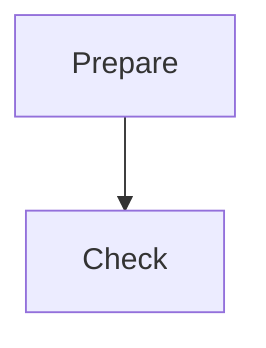

<a id="tour"></a>
# Tour

The [writer](nested/home.md#writer) checks requests.
See the [literal value](nested/home.md?mode=read#default).
A [reference][home] also resolves.

[home]: nested/home.md#writer



```ts
const value = "<literal>";
```
